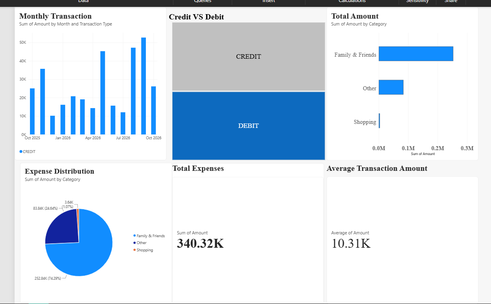
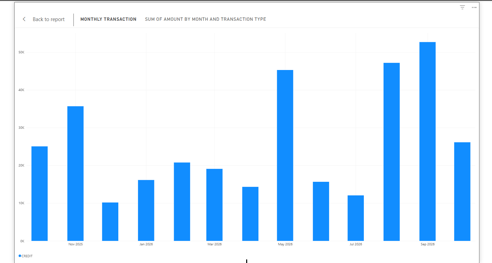

# Personal Finance Tracker & Power BI Dashboard

Analysis of **917 transactions over 13 months** (Oct 2025 to Oct 2026) of my UPI history (PhonePe statement) using Python, Pandas, Matplotlib and Power BI, to understand where my money goes and when spending exceeds income.

## Problem
Raw UPI statements are hard to read: junk rows, text dates and amounts, and no categories. I wanted to turn mine into clear monthly insights about spending and cash flow.

## What I Did
- Cleaned the raw statement (removed junk rows, converted text dates and amounts to proper types)
- Categorised transactions into **7 categories** using keyword rules on payee names
- Compared money in vs. money out for each month
- Identified the months where spending exceeded money in
- Built an interactive Power BI dashboard with KPI cards, a transaction-type slicer, and category and monthly charts

## Key Findings
| Metric | Value |
|---|---|
| Transactions analysed | 917 |
| Period | 13 months (Oct 2025 to Oct 2026) |
| Total money in | ₹3,40,324 |
| Total money out | ₹2,83,298 |
| Net cash flow | +₹57,026 |

**Spending by category (keyword-based):**
- Transfers to individuals: about 61%
- Education fees: 30.5% (₹86,402)
- Shopping, groceries, food and transport together: about 7%
- Other: 1.5%

**Insights**
- Overall cash flow was positive, but **spending exceeded money in during 4 of 13 months** (Oct 2025, Mar 2026, Apr 2026 and Jun 2026).
- Education fee payments were the largest single payment in 3 of those 4 months, and a large transfer drove the fourth.
- Large, irregular payments, not everyday spending, caused the deficits.

## Recommendation
Set aside a fixed amount each month for large, irregular payments such as fees, and keep a buffer from high-income months so that deficit months are covered.

## Dashboard

### Monthly Trends

## Tech Stack
- **Python:** Pandas, Matplotlib
- **Power BI:** KPI cards, slicers, category and monthly charts
- **Tools:** Jupyter Notebook / Google Colab, VS Code, Git/GitHub

## Project Files
| File | Description |
|------|-------------|
| `Finance_tracker_public.ipynb` | Data cleaning, categorisation and analysis |
| `Finance-Report-Dashboard.pbix` | Power BI dashboard (open in Power BI Desktop) |

## How to Run
1. Clone the repo: `git clone https://github.com/Aniksha04/Personal-Finance-Tracker.git`
2. Install the libraries: `pip install pandas matplotlib jupyter`
3. Open `Finance_tracker_public.ipynb` and run all cells
4. Open the `.pbix` file in Power BI Desktop to explore the dashboard

## Notes
- Categories are assigned with keyword rules, so a few small payments may be mislabelled.
- The original data is private and not included. Names in the code are placeholders.

## Author
**Aniksha Shinde** | [GitHub](https://github.com/Aniksha04) | [LinkedIn](https://linkedin.com/in/aniksha-shinde-87987843b)
